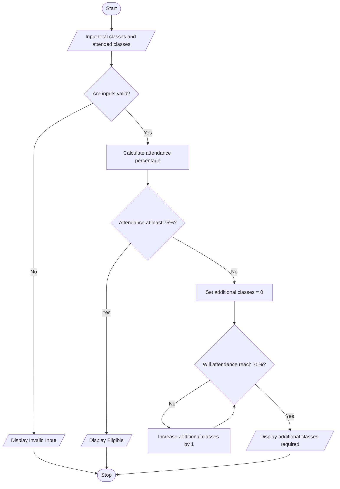

# Case Study 1: Attendance Recovery Computation

**PDF topic number:** 12  
**Subject:** Python Activity-Based Learning

## 1. Problem Statement

Develop a Python program to calculate a student's attendance percentage based on the total number of classes conducted and the number of classes attended. If attendance is below 75%, determine the minimum number of additional consecutive classes the student must attend to reach 75%.

## 2. Objectives

- Calculate the student's attendance percentage.
- Check whether the student meets the 75% attendance requirement.
- Find the minimum number of additional classes needed.
- Validate input values.

## 3. Assumptions

1. Total classes conducted must be greater than zero.
2. Attended classes cannot be negative or greater than total classes.
3. Required attendance is 75%.
4. The student attends every upcoming class.
5. Class counts are whole numbers.

## 4. Algorithm

1. Start.
2. Input total classes conducted and classes attended.
3. Check whether the inputs are valid.
4. If the inputs are invalid, display an error message.
5. Otherwise, calculate attendance percentage.
6. If attendance is at least 75%, display that the student is eligible.
7. Otherwise, set the additional class count to zero.
8. Use a while loop to increase the count until attendance reaches 75%.
9. Display the minimum additional classes required.
10. Stop.

## 5. Flowchart



## 6. Pseudocode

```text
START
INPUT total_classes
INPUT attended_classes

IF total_classes <= 0 OR attended_classes < 0
   OR attended_classes > total_classes THEN
    DISPLAY "Invalid input"
ELSE
    percentage = attended_classes / total_classes * 100
    DISPLAY percentage

    IF percentage >= 75 THEN
        DISPLAY "Eligible"
    ELSE
        additional = 0
        WHILE (attended_classes + additional) /
              (total_classes + additional) * 100 < 75
            additional = additional + 1
        END WHILE
        DISPLAY additional
    END IF
END IF

STOP
```

## 7. Python Source Code

The complete program is in [main.py](main.py).

## 8. Test Cases

| Test | Total classes | Attended | Expected result |
|---|---:|---:|---|
| 1 | 40 | 25 | 62.5%; needs 20 additional classes |
| 2 | 40 | 32 | 80%; already eligible |
| 3 | 40 | 45 | Invalid input |
| 4 | 40 | 30 | 75%; already eligible |
| 5 | 0 | 0 | Invalid input |

### Sample output: Test Case 1

```text
Enter total classes conducted: 40
Enter classes attended: 25
Attendance percentage: 62.5 %
You are not eligible yet.
Additional classes required: 20
```

## 9. Output Screenshot

After running `main.py`, take a screenshot of the program output and save it in this folder as `output.png`. The screenshot has not been added yet.

## 10. Conclusion

This program calculates a student's attendance percentage and checks eligibility against a 75% requirement. If attendance is below the requirement, it uses a while loop to find the minimum number of additional consecutive classes needed. The program demonstrates variables, arithmetic operators, conditional statements, input validation, and loops.
