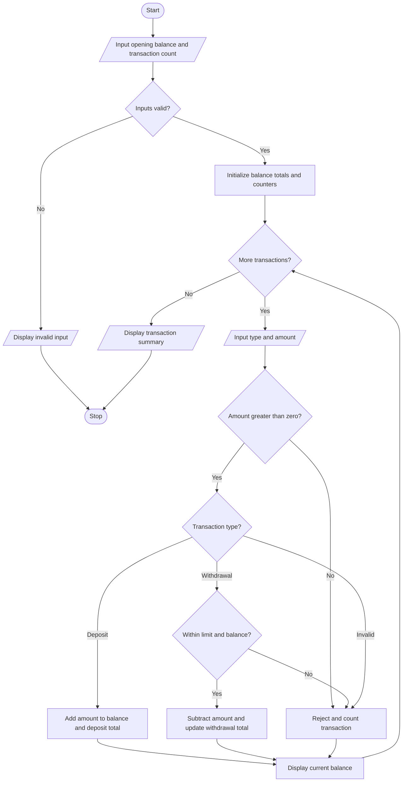

# Case Study 2: ATM Transaction Sequence Simulation

**PDF topic number:** 13  
**Subject:** Python Activity-Based Learning

## 1. Problem Statement

Create a Python program that processes a sequence of ATM deposits and withdrawals. The program must maintain the account balance, enforce a withdrawal limit, reject invalid transactions, and display a summary of all transactions.

## 2. Objectives

- Process a sequence of deposit and withdrawal transactions.
- Update and maintain the simulated account balance.
- Enforce a per-transaction withdrawal limit.
- Reject invalid amounts, invalid transaction types, and withdrawals that exceed the balance.
- Summarize successful and rejected transactions.

## 3. Assumptions

1. The opening balance cannot be negative.
2. The number of transactions must be zero or greater.
3. Each transaction amount must be greater than zero.
4. The maximum permitted withdrawal per transaction is Rs. 10,000.
5. A withdrawal cannot exceed the current balance.
6. The program accepts `D` for deposit and `W` for withdrawal; input is case-insensitive.
7. This is a learning simulation and does not connect to a real bank or ATM.

## 4. Algorithm

1. Start.
2. Input the opening balance and number of transactions.
3. Validate the opening balance and transaction count.
4. Initialize counters and totals for deposits, withdrawals, and rejected transactions.
5. Repeat for each transaction:
   - Input the transaction type and amount.
   - Reject the transaction if the amount is not positive.
   - If it is a deposit, add the amount to the balance and update deposit totals.
   - If it is a withdrawal, check the withdrawal limit and available balance before deducting.
   - Reject any unknown transaction type.
   - Display the current balance.
6. Display the transaction summary and final balance.
7. Stop.

## 5. Flowchart



## 6. Pseudocode

```text
START
INPUT opening_balance
INPUT transaction_count

IF opening_balance < 0 OR transaction_count < 0 THEN
    DISPLAY "Invalid input"
ELSE
    INITIALIZE deposit_count, withdrawal_count, rejected_count
    INITIALIZE total_deposited, total_withdrawn

    FOR each transaction in transaction_count
        INPUT transaction_type
        INPUT amount

        IF amount <= 0 THEN
            REJECT transaction
            INCREASE rejected_count
        ELSE IF transaction_type is "D" THEN
            ADD amount to balance
            UPDATE deposit total and count
        ELSE IF transaction_type is "W" THEN
            IF amount > withdrawal_limit OR amount > balance THEN
                REJECT transaction
                INCREASE rejected_count
            ELSE
                SUBTRACT amount from balance
                UPDATE withdrawal total and count
            END IF
        ELSE
            REJECT transaction
            INCREASE rejected_count
        END IF

        DISPLAY current balance
    END FOR

    DISPLAY transaction counts, totals, and final balance
END IF
STOP
```

## 7. Python Source Code

The complete program is saved in [main.py](main.py).

## 8. Test Cases

| Test | Opening balance | Transactions | Expected result |
|---|---:|---|---|
| 1 | Rs. 1,000 | Deposit Rs. 500; withdraw Rs. 300 | Final balance Rs. 1,200; one successful deposit and one successful withdrawal |
| 2 | Rs. 500 | Withdraw Rs. 600 | Transaction rejected for insufficient balance; balance remains Rs. 500 |
| 3 | Rs. 20,000 | Withdraw Rs. 12,000 | Transaction rejected because it exceeds the Rs. 10,000 withdrawal limit |
| 4 | Rs. 1,000 | Deposit Rs. 0 | Transaction rejected because the amount must be positive |
| 5 | Rs. 1,000 | Transaction type `X`, amount Rs. 100 | Transaction rejected because the type is invalid |

### Sample output

For an opening balance of Rs. 1,000 and three transactions (deposit Rs. 500, withdraw Rs. 300, then attempt to withdraw Rs. 1,500), the summary should show:

```text
Successful deposits: 1
Successful withdrawals: 1
Rejected transactions: 1
Total amount deposited: Rs. 500.0
Total amount withdrawn: Rs. 300.0
Final balance: Rs. 1200.0
```

## 9. Output Screenshot

Run `main.py` in Python and capture the terminal output. Save the screenshot in this folder as `output.png`. The screenshot has not been added yet.

## 10. Conclusion

The ATM transaction simulation processes deposits and withdrawals in sequence while updating the balance after each transaction. It demonstrates variables, arithmetic operators, conditional statements, a `for` loop, input validation, and transaction summaries. The withdrawal limit and balance check help ensure that invalid withdrawals are rejected safely.
