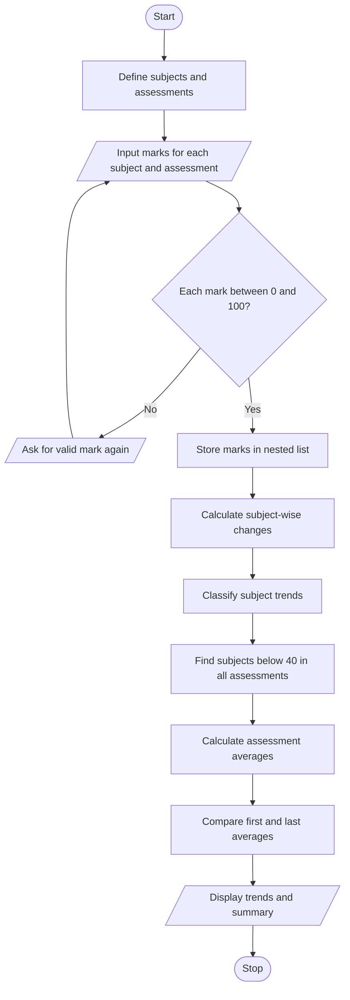

# Case Study 3: Student Performance Trend Analysis

**PDF topic number:** 17  
**Subject:** Python Activity-Based Learning

## 1. Problem Statement

Compare a student's marks across three assessments for multiple subjects. Calculate changes in marks, identify subjects that remain weak across all assessments, and classify the overall performance trend.

## 2. Objectives

- Store marks for multiple subjects and assessments.
- Calculate the change between the first and last assessments.
- Identify whether each subject improved, declined, or stayed the same.
- Calculate average marks for each assessment.
- Identify subjects with marks below 40 in all three assessments.
- Classify the overall trend based on the change in average marks.

## 3. Assumptions

1. The example program analyses three subjects: Mathematics, English, and Python.
2. It analyses three assessments.
3. Each mark must be a number between 0 and 100, inclusive.
4. A positive change means improvement; a negative change means decline; zero means no change.
5. A subject is considered consistently weak if its mark is below 40 in every assessment. This is a rule chosen for this case study, not a universal grading policy.
6. The overall trend compares the average of Assessment 3 with the average of Assessment 1.

## 4. Algorithm

1. Start.
2. Define the subject names and assessment names.
3. For each assessment, input marks for every subject.
4. Validate each mark so it is between 0 and 100.
5. Store marks in a nested list.
6. For each subject, calculate the change between Assessment 1 and Assessment 3.
7. Display whether each subject improved, declined, or remained unchanged.
8. Identify subjects with marks below 40 in all three assessments.
9. Calculate and display the average mark for each assessment.
10. Compare the first and third assessment averages and classify the overall trend.
11. Stop.

## 5. Flowchart



## 6. Pseudocode

```text
START
DEFINE subjects and assessments
CREATE empty marks list

FOR each assessment
    CREATE empty assessment_marks list
    FOR each subject
        INPUT score
        WHILE score is outside 0 to 100
            INPUT score again
        END WHILE
        ADD score to assessment_marks
    END FOR
    ADD assessment_marks to marks
END FOR

FOR each subject
    change = final_assessment_mark - first_assessment_mark
    DISPLAY change
    IF change > 0
        DISPLAY "Improved"
    ELSE IF change < 0
        DISPLAY "Declined"
    ELSE
        DISPLAY "No change"
    END IF

    IF marks are below 40 in every assessment
        RECORD subject as consistently weak
    END IF
END FOR

CALCULATE average for each assessment
overall_change = final_average - first_average
CLASSIFY overall trend using overall_change
DISPLAY averages, trends, and weak subjects
STOP
```

## 7. Python Source Code

The complete program is saved in [main.py](main.py). It uses a nested list to store marks and loops to process subjects and assessments.

## 8. Test Cases

Use the following marks to test the program:

| Subject | Assessment 1 | Assessment 2 | Assessment 3 | Change |
|---|---:|---:|---:|---:|
| Mathematics | 50 | 60 | 70 | +20 |
| English | 65 | 65 | 60 | -5 |
| Python | 30 | 35 | 38 | +8 |

Expected analysis:
- Mathematics: Improved.
- English: Declined.
- Python: Improved, but consistently weak because all three marks are below 40.
- Assessment 1 average: 48.33.
- Assessment 2 average: 53.33.
- Assessment 3 average: 56.00.
- Overall change from Assessment 1 to Assessment 3: +7.67, so the overall trend is Improved.

Additional validation test: enter a mark of 120. The program should reject it and ask for a valid mark between 0 and 100.

## 9. Output Screenshot

Run `main.py`, enter the test marks above, and capture the terminal output. Save the screenshot in this folder as `output.png`. The screenshot has not been added yet.

## 10. Conclusion

This program analyses marks across three assessments, calculates subject-wise changes and assessment averages, and identifies consistently weak subjects. It demonstrates variables, arithmetic operators, conditionals, loops, input validation, lists, and nested lists. The trend classifications are based on the explicit rules defined in this report.
