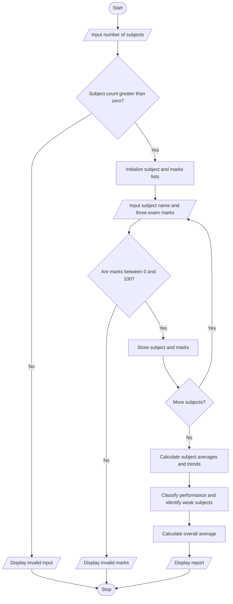

# Case Study 3: Student Performance Trend Analysis

**PDF topic number:** 17  
**Subject:** Python Activity-Based Learning

## 1. Problem Statement

Compare a student's marks across three examinations for multiple subjects. Calculate subject averages, measure improvement or decline between the first and third examinations, identify subjects with low average marks, and classify overall performance using defined criteria.

## 2. Objectives

- Store subject names and examination marks using lists.
- Calculate average marks for each subject.
- Compare the first and third examination marks to identify trends.
- Identify subjects with an average below 40%.
- Classify subject-wise and overall performance using fixed thresholds.

## 3. Assumptions

1. At least one subject must be entered.
2. Each subject has marks for three examinations.
3. Marks must be between 0 and 100, inclusive.
4. Subject average classifications are: 75 and above = Excellent; 60 to below 75 = Good; 40 to below 60 = Needs Improvement; below 40 = At Risk.
5. A subject with an average below 40% is flagged as needing attention.
6. Trend is measured as Exam 3 marks minus Exam 1 marks.
7. This is a simple learning exercise; it uses the entered marks and does not represent an official institutional grading policy.

## 4. Algorithm

1. Start.
2. Input the number of subjects and validate that it is greater than zero.
3. Create lists to store subject names and marks.
4. For each subject, input its name and marks for three examinations.
5. Validate every mark is between 0 and 100.
6. For each subject:
   - Calculate the average of the three marks.
   - Calculate the change from Exam 1 to Exam 3.
   - Identify whether the trend improved, declined, or remained unchanged.
   - Classify the subject using the specified average thresholds.
   - Add subjects with averages below 40% to the weak-subject list.
7. Calculate the overall average across all subjects and examinations.
8. Display the overall classification and subjects needing attention.
9. Stop.

## 5. Flowchart



## 6. Pseudocode

```text
START
INPUT subject_count

IF subject_count <= 0 THEN
    DISPLAY "Invalid input"
ELSE
    CREATE subjects list
    CREATE marks_list

    FOR each subject
        INPUT subject name
        INPUT marks for Exam 1, Exam 2, Exam 3
        VALIDATE every mark is between 0 and 100
        STORE subject and marks
    END FOR

    FOR each stored subject
        average = sum(marks) / 3
        change = Exam 3 marks - Exam 1 marks

        IF average >= 75 THEN
            category = "Excellent"
        ELSE IF average >= 60 THEN
            category = "Good"
        ELSE IF average >= 40 THEN
            category = "Needs Improvement"
        ELSE
            category = "At Risk"
        END IF

        IF average < 40 THEN
            ADD subject to weak_subjects
        END IF

        DISPLAY average, change, trend, category
    END FOR

    CALCULATE overall average
    DISPLAY overall classification and weak subjects
END IF
STOP
```

## 7. Python Source Code

The complete program is saved in [main.py](main.py).

## 8. Test Cases

| Test | Subject marks (Exam 1, Exam 2, Exam 3) | Expected result |
|---|---|---|
| 1 | Mathematics: 65, 72, 80 | Average 72.33; improved by 15; Good |
| 2 | Science: 55, 50, 45 | Average 50; declined by 10; Needs Improvement |
| 3 | English: 35, 38, 40 | Average 37.67; improved by 5; At Risk; flagged for attention |
| 4 | Any subject: 70, 105, 80 | Invalid marks; program asks the user to run again with valid marks |
| 5 | Subject count: 0 | Invalid input |

### Sample data for a full run

- Mathematics: 65, 72, 80
- Science: 55, 50, 45
- English: 35, 38, 40

Expected overall average: **53.33%**  
Expected overall classification: **Needs Improvement**  
Subject needing attention: **English**

## 9. Output Screenshot

Run `main.py` and enter the sample data above. Capture the terminal output and save it in this folder as `output.png`. The screenshot has not been added yet.

## 10. Conclusion

This program analyses marks across three examinations, calculates averages, compares the first and final examination scores, and identifies subjects requiring attention. It demonstrates variables, arithmetic operators, conditionals, loops, strings, lists, and input validation. The classifications are based on the thresholds stated in this report and can be changed if an instructor provides a different policy.
