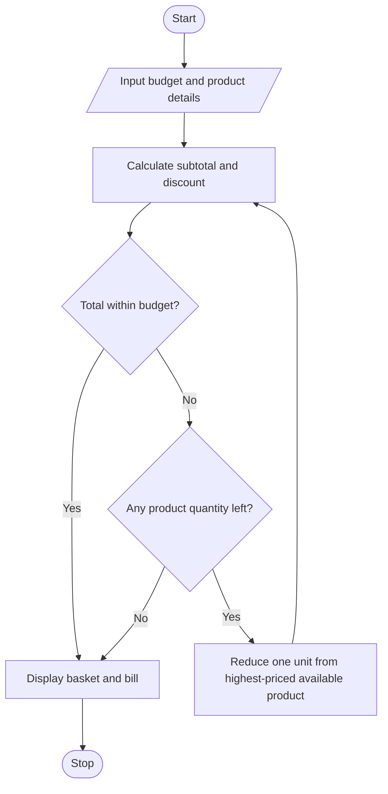

# Case Study 4: Multi-Product Shopping Budget Constraint

## 1. Problem Statement
Evaluate a shopping basket containing multiple products and quantities, apply discount conditions, and determine which purchases must be reduced to remain within a fixed budget.

## 2. Objectives
- Read product names, unit prices, quantities, and the shopper's budget.
- Calculate the basket subtotal and apply a threshold-based discount.
- Check whether the discounted total fits the budget.
- If needed, reduce quantities one unit at a time, starting with the most expensive available product, until the basket fits the budget.
- Display the revised basket, discount, final total, and remaining money.

## 3. Assumptions
1. All prices and the budget are entered in Indian rupees (Rs).
2. Unit prices and quantities cannot be negative; zero quantity is allowed.
3. A 10% discount applies when the current subtotal is at least Rs 5,000.
4. A 5% discount applies when the current subtotal is at least Rs 2,500 but below Rs 5,000. Otherwise, no discount applies.
5. The discount is recalculated after each quantity reduction.
6. To fit the budget, the program removes one unit at a time from the product with the highest unit price among products that still have a positive quantity. This is a simple policy for the exercise, not necessarily the best shopping decision for every person.

## 4. Algorithm
1. Start.
2. Input and validate the shopping budget and number of products.
3. For each product, input and validate its name, unit price, and quantity.
4. Store the original basket for reporting.
5. Calculate the subtotal and determine the discount rate from the threshold rules.
6. Calculate the discounted total and compare it with the budget.
7. While the total exceeds the budget, reduce one unit from the most expensive product that has remaining quantity, then recalculate the subtotal, discount, and total.
8. Display the original basket and the recommended revised basket.
9. Display the final total, money remaining, and reduction details.
10. Stop.

## 5. Flowchart


## 6. Pseudocode
```text
START
INPUT budget and number_of_products
INPUT each product name, price, and quantity
SAVE a copy of the original basket

CALCULATE subtotal
IF subtotal >= 5000
    discount_rate = 10%
ELSE IF subtotal >= 2500
    discount_rate = 5%
ELSE
    discount_rate = 0%
END IF
total = subtotal - discount

WHILE total > budget
    FIND the highest-priced product with quantity > 0
    IF no such product exists
        BREAK
    END IF
    REDUCE its quantity by 1
    RECALCULATE subtotal, discount rate, discount, and total
END WHILE

DISPLAY original basket and original bill
DISPLAY revised basket, final bill, and remaining budget
DISPLAY quantity reductions
STOP
```

## 7. Python Source Code
Save the program below as `main.py`.

```python
"""
Case Study 4: Multi-Product Shopping Budget Constraint
Evaluates a shopping basket, applies threshold discounts, and reduces quantities
until the total fits within the shopper's budget.
"""

def calculate_bill(products):
    subtotal = sum(price * quantity for name, price, quantity in products)
    if subtotal >= 5000:
        discount_rate = 0.10
    elif subtotal >= 2500:
        discount_rate = 0.05
    else:
        discount_rate = 0.0
    discount = subtotal * discount_rate
    return subtotal, discount, subtotal - discount, discount_rate


def main():
    print("MULTI-PRODUCT SHOPPING BUDGET PLANNER")
    budget = float(input("Enter your shopping budget (Rs): "))
    while budget < 0:
        print("Budget cannot be negative.")
        budget = float(input("Enter your shopping budget (Rs): "))

    count = int(input("Enter number of different products: "))
    while count <= 0:
        print("Please enter at least one product.")
        count = int(input("Enter number of different products: "))

    products = []
    for i in range(count):
        print(f"\nProduct {i + 1}")
        name = input("Product name: ").strip()
        while not name:
            print("Product name cannot be empty.")
            name = input("Product name: ").strip()

        price = float(input("Unit price (Rs): "))
        while price < 0:
            print("Price cannot be negative.")
            price = float(input("Unit price (Rs): "))

        quantity = int(input("Quantity: "))
        while quantity < 0:
            print("Quantity cannot be negative.")
            quantity = int(input("Quantity: "))

        products.append([name, price, quantity])

    original = [item.copy() for item in products]
    original_subtotal, original_discount, original_total, original_rate = calculate_bill(products)

    print("\n--- ORIGINAL BASKET ---")
    for name, price, quantity in original:
        print(f"{name}: {quantity} x Rs {price:.2f} = Rs {price * quantity:.2f}")
    print(f"Subtotal: Rs {original_subtotal:.2f}")
    print(f"Discount rate: {original_rate * 100:.0f}%")
    print(f"Discount: Rs {original_discount:.2f}")
    print(f"Total after discount: Rs {original_total:.2f}")
    print(f"Budget: Rs {budget:.2f}")

    reductions = []
    while calculate_bill(products)[2] > budget:
        candidates = [item for item in products if item[2] > 0]
        if not candidates:
            break
        selected = max(candidates, key=lambda item: item[1])
        selected[2] -= 1
        reductions.append(selected[0])

    subtotal, discount, final_total, rate = calculate_bill(products)

    print("\n--- RECOMMENDED BASKET ---")
    for name, price, quantity in products:
        print(f"{name}: {quantity} x Rs {price:.2f} = Rs {price * quantity:.2f}")
    print(f"Revised subtotal: Rs {subtotal:.2f}")
    print(f"Discount rate: {rate * 100:.0f}%")
    print(f"Discount: Rs {discount:.2f}")
    print(f"Final total: Rs {final_total:.2f}")
    print(f"Money remaining: Rs {budget - final_total:.2f}")

    if reductions:
        print("\nQuantity reductions made (one unit at a time):")
        for name in reductions:
            print(f"- Removed one unit of {name}")
    else:
        print("\nYour original basket is already within budget; no reductions needed.")

    if final_total <= budget:
        print("Status: Basket fits within budget.")
    else:
        print("Status: Unable to fit the basket within budget.")


if __name__ == "__main__":
    main()
```

## 8. Test Cases

| Test | Input summary | Expected result |
|---|---|---|
| 1 | Budget Rs 3,000; rice Rs 1,000 × 1; oil Rs 1,200 × 1 | Subtotal Rs 2,200, no discount; basket fits; no reductions |
| 2 | Budget Rs 4,000; laptop bag Rs 2,000 × 2; book Rs 500 × 2 | Subtotal Rs 5,000; 10% discount; total Rs 4,500; reduce one unit of the highest-priced product, then recalculate |
| 3 | Budget Rs 500; item Rs 100 × 2 | Total Rs 200; basket fits; no reductions |
| 4 | Budget Rs 0; item Rs 100 × 2 | Quantities reduced to zero; final total Rs 0 |
| 5 | Negative budget or negative price/quantity | Program asks for valid non-negative input again |

## 9. Sample Output
Example input:
- Budget: Rs 4,000
- Product 1: Laptop Bag, unit price Rs 2,000, quantity 2
- Product 2: Notebook, unit price Rs 500, quantity 2

Expected key calculations:
- Original subtotal = Rs 5,000
- Original discount = 10% = Rs 500
- Original total = Rs 4,500
- Remove one laptop bag: revised subtotal = Rs 3,000; discount = 5% = Rs 150; final total = Rs 2,850
- Remaining budget = Rs 1,150

**Output screenshot:** Run `main.py` in a terminal with the sample input and save a screenshot of the program output as `output.png` in this folder. Add the screenshot to the repository to complete the screenshot deliverable.

## 10. Conclusion
The program demonstrates input validation, variables, arithmetic operators, conditional statements, loops, lists, list copying, and processing records. It calculates threshold discounts and recommends a quantity-reduced basket that fits within the user's budget under the stated reduction policy.
