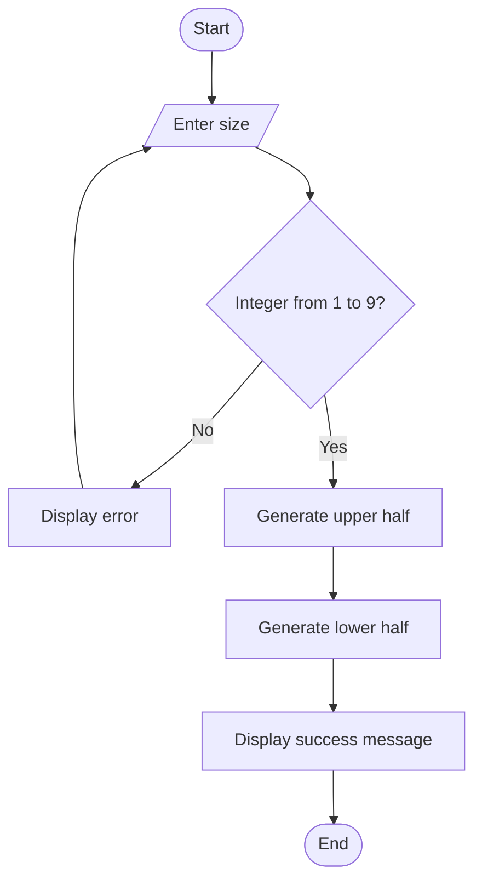

# Case Study 5: Advanced Numeric Pattern Generator

## 1. Problem Statement
Produce a carefully aligned hollow diamond numeric pattern using a user-specified dimension. Validate invalid dimensions before generating the pattern.

## 2. Objectives
- Use nested/repeated loops to generate a symmetric pattern.
- Apply strings and spacing to align the output.
- Validate input and handle non-numeric or out-of-range values.
- Display a hollow diamond with matching numbers at each row's edges.

## 3. Assumptions
- The dimension must be a whole number from 1 to 9.
- The row number is printed at both ends of each row, with spaces between the edges.
- The diamond has an upper half and a lower half; the middle row is printed only once.
- The program uses only basic Python input, strings, loops, and conditionals.

## 4. Algorithm
1. Display the program heading.
2. Ask the user for the diamond size.
3. If input is not an integer or is outside 1–9, display an error and ask again.
4. For rows 1 through size, print leading spaces and the row number at the left and right edges.
5. For rows size−1 down to 1, print the lower half in reverse order.
6. Display a success message and stop.

## 5. Flowchart



## 6. Pseudocode

```text
START
REPEAT
    INPUT size
    IF size is not an integer from 1 to 9
        DISPLAY error
UNTIL size is valid

FOR row = 1 TO size
    DISPLAY leading spaces
    IF row equals 1
        DISPLAY row
    ELSE
        DISPLAY row, inner spaces, row
FOR row = size - 1 DOWN TO 1
    DISPLAY leading spaces
    IF row equals 1
        DISPLAY row
    ELSE
        DISPLAY row, inner spaces, row
DISPLAY success message
STOP
```

## 7. Python Source Code

See [main.py](main.py) in this folder.

## 8. Test Cases

| Test input | Expected behaviour |
|---|---|
| `1` | Prints a one-row diamond containing `1` |
| `3` | Prints a symmetric hollow diamond with rows 1, 2, 3, 2, 1 |
| `5` | Prints a symmetric hollow diamond with rows 1 through 5 and back to 1 |
| `0` | Rejects the value and asks again |
| `10` | Rejects the value and asks again |
| `hello` | Handles non-numeric input and asks again |

## 9. Sample Output

For input `5`:

```text
ADVANCED NUMERIC PATTERN GENERATOR
----------------------------------
Enter diamond size (1-9): 5
    1
   2 2
  3   3
 4     4
5       5
 4     4
  3   3
   2 2
    1
Pattern generated successfully.
```

**Output screenshot:** Run `main.py` in Python or IntelliJ/PyCharm, enter `5`, and save a screenshot of the console as `output.png` in this case-study folder.

## 10. Conclusion
The program generates a hollow diamond pattern with aligned spacing and symmetry. Input validation prevents invalid dimensions, while loops, conditionals, and string operations demonstrate fundamental Python programming concepts.
