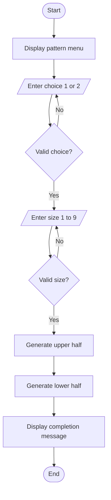

# Case Study 5: Advanced Numeric Pattern Generator

## 1. Problem Statement
Develop an interactive Python program that lets the user choose between a symmetric filled numeric diamond and a hollow numeric diamond. The program must accept a dimension, validate inputs, and display a carefully aligned pattern.

## 2. Objectives
- Generate two different diamond patterns using loops.
- Use nested loops, strings, conditionals, and spacing.
- Accept the user's pattern selection.
- Validate the menu choice and the size.
- Produce a symmetric, aligned output.

## 3. Assumptions
- Pattern choice `1` means a filled symmetric diamond; choice `2` means a hollow diamond.
- The size must be a whole number from 1 to 9.
- The filled diamond prints ascending numbers and then descending numbers in each row.
- The hollow diamond prints the row number at the left and right edges, leaving spaces inside.
- The middle row is displayed only once.

## 4. Algorithm
1. Display the title and pattern menu.
2. Ask the user to choose pattern 1 or 2. Repeat the prompt for invalid choices.
3. Ask for a size from 1 to 9. Repeat the prompt for non-integer or out-of-range input.
4. Generate the upper half of the selected diamond, including the middle row.
5. Generate the lower half in reverse order, excluding the middle row.
6. Display a completion message identifying the selected pattern.

## 5. Flowchart



## 6. Pseudocode

```text
START
DISPLAY pattern menu
REPEAT
    INPUT choice
UNTIL choice is 1 or 2

REPEAT
    INPUT size
UNTIL size is an integer from 1 to 9

FOR row from 1 to size
    DISPLAY leading spaces
    IF choice is 1
        DISPLAY ascending numbers and descending numbers
    ELSE
        DISPLAY row number at both edges with inner spaces
FOR row from size - 1 down to 1
    DISPLAY leading spaces
    IF choice is 1
        DISPLAY ascending numbers and descending numbers
    ELSE
        DISPLAY row number at both edges with inner spaces

DISPLAY completion message
STOP
```

## 7. Python Source Code
See [main.py](main.py) in this folder.

## 8. Test Cases

| Pattern choice | Size | Expected result |
|---|---:|---|
| 1 | 3 | Filled symmetric diamond |
| 2 | 3 | Hollow diamond |
| 1 | 1 | Single number `1` |
| 2 | 1 | Single number `1` |
| 3 | 3 | Invalid choice rejected; user is prompted again |
| 1 | 0 | Invalid size rejected; user is prompted again |
| 2 | `abc` | Non-numeric size handled without crashing |

## 9. Sample Outputs

### Option 1: Symmetric filled diamond (size 4)

```text
   1
  121
 12321
1234321
 12321
  121
   1
```

### Option 2: Hollow diamond (size 4)

```text
   1
  2 2
 3   3
4     4
 3   3
  2 2
   1
```

**Output screenshots:** Run the program twice: once with choice `1` and size `4`, and once with choice `2` and size `4`. Save the console screenshots in this folder as `output_filled.png` and `output_hollow.png`.

## 10. Conclusion
The interactive program gives users two numeric pattern options. It demonstrates loops, nested loops, conditionals, strings, and input validation while producing symmetric, carefully aligned output.
