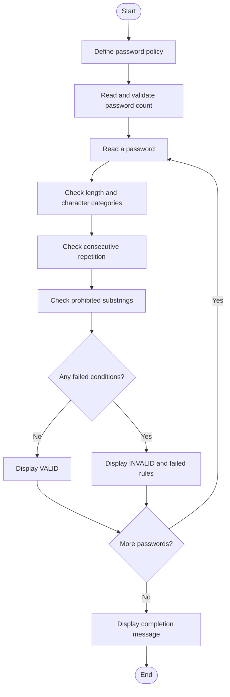

# Case Study 6: Password Policy Validation Engine

## 1. Problem Statement
Develop a Python program that evaluates sample password strings against minimum-length, character-category, repetition, and prohibited-substring rules. The program must explain every condition that a password fails.

## 2. Objectives
- Check whether a password has at least 8 characters.
- Check for an uppercase letter, a lowercase letter, a digit, and a special character.
- Reject three or more identical characters consecutively.
- Reject passwords containing the prohibited substrings `password`, `admin`, or `1234`, regardless of letter case.
- Display whether each password is valid and list all failed rules.

## 3. Assumptions
- The minimum password length is 8 characters.
- A special character is any character that is not an uppercase letter, lowercase letter, or digit.
- Three identical characters in a row count as a repetition-policy violation.
- Prohibited substrings are checked without case sensitivity.
- These rules are educational examples supplied for this case study; they are not a claim that one universal password policy exists.

## 4. Algorithm
1. Start the program and define the password policy.
2. Ask how many passwords will be checked; validate that the count is a positive integer.
3. For each password, create an empty list of failed conditions.
4. Check the minimum length.
5. Scan the password and record whether uppercase, lowercase, digit, and special-character categories are present.
6. Check whether any character appears three times consecutively.
7. Search for each prohibited substring after converting the password to lowercase.
8. If no conditions failed, display VALID; otherwise display INVALID and list every failed condition.
9. Repeat until all passwords have been checked, then stop.

## 5. Flowchart



## 6. Pseudocode
```text
START
SET minimum length to 8
SET prohibited substrings to password, admin, 1234
READ number of passwords
WHILE count is not a positive integer
    DISPLAY input error
    READ count again
END WHILE

FOR each password
    READ password
    SET failed conditions to empty list

    IF password length is less than 8
        ADD minimum-length failure
    END IF

    CHECK uppercase, lowercase, digit, and special character
    ADD a failure for each missing category

    CHECK each group of 3 consecutive characters
    IF all 3 characters are identical
        ADD repetition failure
    END IF

    CONVERT password to lowercase
    FOR each prohibited substring
        IF substring occurs in password
            ADD prohibited-substring failure
        END IF
    END FOR

    IF failed conditions is empty
        DISPLAY VALID
    ELSE
        DISPLAY INVALID and every failed condition
    END IF
END FOR

DISPLAY completion message
STOP
```

## 7. Python Source Code
See [main.py](main.py) in this folder.

## 8. Test Cases

| Password | Expected result | Reason |
|---|---|---|
| `Student@2026` | Valid | Meets all defined rules |
| `short1A!` | Invalid | Fewer than 8 characters |
| `lowercase9!` | Invalid | No uppercase letter |
| `UPPERCASE9!` | Invalid | No lowercase letter |
| `NoDigits!!` | Invalid | No digit |
| `NoSpecial123` | Invalid | No special character |
| `Abc111!xyz` | Invalid | Three consecutive identical digits |
| `Admin@2026X` | Invalid | Contains prohibited substring `admin` |

## 9. Sample Output
For one password, `Student@2026`:

```text
PASSWORD POLICY VALIDATION ENGINE
----------------------------------
How many passwords do you want to check? 1

Enter password 1: Student@2026
Result:
VALID - Password satisfies all policy rules.

Password checking completed.
```

A failed-password example:

```text
Enter password 1: Abc111!xyz
Result:
INVALID - Password does not satisfy the policy.
Failed conditions:
- Repetition: do not use the same character 3 times in a row
```

## 10. Conclusion
The program uses strings, loops, conditionals, and lists to validate multiple passwords. It checks several policy rules independently and reports each failed condition, making the result easier to understand and correct.
