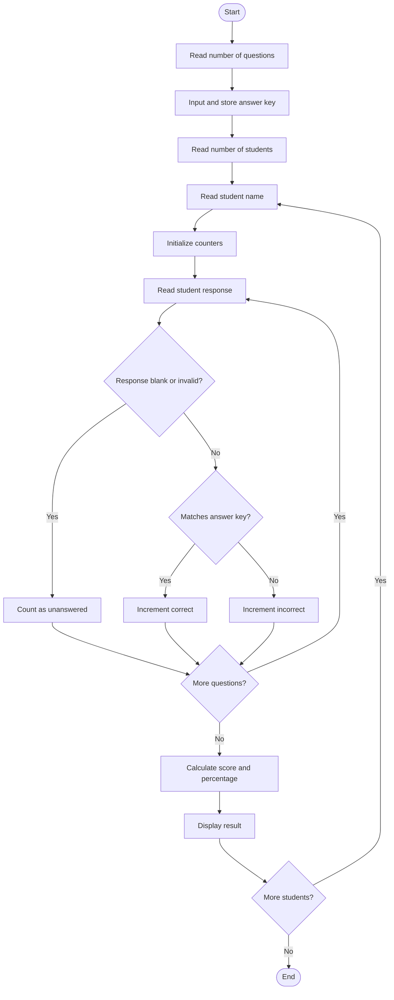

# Case Study 7: String-Based Examination Answer Evaluation

## 1. Problem Statement
Develop a Python program that compares students' answer strings with a supplied answer key, counts correct, incorrect, and unanswered responses, applies negative marking, and displays a result summary for each student.

## 2. Objectives
- Store the correct answers in a list.
- Accept answers from multiple students.
- Compare each response with the corresponding answer-key entry.
- Count correct, incorrect, and unanswered responses.
- Apply positive marks for correct answers and negative marks for incorrect answers.
- Display the final score and score percentage.

## 3. Assumptions
- Each question has four possible options: A, B, C, or D.
- Correct answer: +1 mark.
- Incorrect answer: -0.25 mark.
- Unanswered question: 0 marks.
- Invalid response entries are treated as unanswered.
- Score percentage is calculated from the net score divided by the maximum possible score. Because negative marking can make a score negative, the percentage can also be negative.

## 4. Algorithm
1. Start the program.
2. Read and validate the number of questions.
3. Read each correct answer and store it in the answer-key list.
4. Read and validate the number of students.
5. For each student, read their name and initialize correct, incorrect, and unanswered counters to zero.
6. For each question, read the response and convert it to uppercase.
7. If the response is empty or invalid, count it as unanswered. If it matches the answer key, count it as correct; otherwise, count it as incorrect.
8. Calculate the net score and percentage.
9. Display the student's result summary.
10. Repeat for all students and stop.

## 5. Flowchart



## 6. Pseudocode

```text
START
READ number of questions
CREATE empty answer key list

FOR each question
    READ correct option
    VALIDATE option is A, B, C, or D
    ADD option to answer key
END FOR

READ number of students
FOR each student
    READ student name
    SET correct, incorrect, unanswered to 0

    FOR each question
        READ response
        CONVERT response to uppercase

        IF response is blank or invalid
            INCREMENT unanswered
        ELSE IF response equals answer key entry
            INCREMENT correct
        ELSE
            INCREMENT incorrect
        END IF
    END FOR

    CALCULATE score = correct - (incorrect * 0.25)
    CALCULATE percentage = score / number of questions * 100
    DISPLAY counts, score, and percentage
END FOR
STOP
```

## 7. Python Source Code
See [main.py](main.py) in this folder.

## 8. Test Cases

Assume the answer key is `A, B, C, D`.

| Student responses | Correct | Incorrect | Unanswered | Score |
|---|---:|---:|---:|---:|
| `A, B, C, D` | 4 | 0 | 0 | 4.00 |
| `A, A, C, D` | 3 | 1 | 0 | 2.75 |
| `A, [blank], B, D` | 2 | 1 | 1 | 1.75 |
| `[blank], [blank], [blank], [blank]` | 0 | 0 | 4 | 0.00 |

## 9. Sample Output

For answer key `A, B, C, D` and student responses `A, A, C, [blank]`:

```text
Result for Student One
Correct answers: 2
Incorrect answers: 1
Unanswered questions: 1
Final score: 1.75 out of 4
Score percentage: 43.75 %
```

## 10. Conclusion
The program uses strings, lists, loops, conditionals, and arithmetic operators to evaluate examination answers. It distinguishes correct, incorrect, and unanswered responses and applies the specified negative-marking rule to produce a clear result summary.
