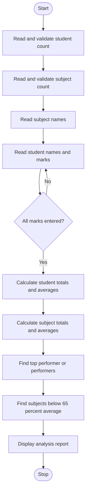

# Case Study 8: Student Marks Matrix Analysis

**Selected topic:** Topic 42 — Student Marks Matrix Analysis

## 1. Problem Statement

Analyse a matrix of student marks across multiple subjects. Calculate row-wise and column-wise statistics, identify the top performer or performers, and detect subjects whose average marks indicate low performance.

## 2. Objectives

- Store marks in a nested list (matrix), with one row per student and one column per subject.
- Calculate each student's total and average marks (row-wise statistics).
- Calculate each subject's total and average marks (column-wise statistics).
- Identify the student or students with the highest average.
- List subjects whose average is below the chosen low-performance threshold.
- Validate the number of students, number of subjects, names, and marks.

## 3. Assumptions

1. The number of students and subjects must each be a positive whole number.
2. Each student's mark in each subject is numeric and ranges from 0 to 100.
3. All students take the same subjects, so each row has the same number of marks.
4. The student's average is the total marks divided by the number of subjects.
5. A subject is flagged as having a low average when its average is **below 65%**. This is an implementation assumption because the case-study description does not specify a threshold.
6. Students tied for the highest average are all reported as top performers.
7. The program uses only basic Python features: variables, input/output, operators, conditions, loops, lists, nested lists, and built-in list/numeric operations.

## 4. Algorithm

1. Start the program.
2. Read and validate the positive number of students.
3. Read and validate the positive number of subjects.
4. Read the subject names and store them in a list.
5. For each student:
   - Read the student's name.
   - Read a mark for each subject.
   - Repeat the mark input if it is non-numeric or outside 0–100.
   - Store the marks as one row in the marks matrix.
6. For each student row, calculate the total and average marks.
7. For each subject column, calculate the total and average marks.
8. Find the highest student average and collect all students who achieved it.
9. Display student-wise and subject-wise statistics.
10. Display top performer(s).
11. Display every subject whose average is below 65%; otherwise display “None”.
12. Stop.

## 5. Flowchart



## 6. Pseudocode

```text
START
INPUT student_count until it is a positive integer
INPUT subject_count until it is a positive integer
INPUT subject names

FOR each student
    INPUT non-empty student name
    FOR each subject
        INPUT mark
        WHILE mark is not numeric or outside 0 to 100
            INPUT mark again
        END WHILE
        APPEND mark to the student's row
    END FOR
    APPEND row to marks matrix
END FOR

FOR each student row
    total = sum of marks in row
    average = total / subject_count
    STORE total and average
END FOR

FOR each subject column
    ADD marks from all student rows
    subject_average = subject_total / student_count
END FOR

highest_average = maximum student average
DISPLAY every student whose average equals highest_average
DISPLAY student-wise and subject-wise statistics
DISPLAY subjects whose average is below 65
IF no subject is below 65
    DISPLAY "None"
END IF
STOP
```

## 7. Python Source Code

The complete program is in [main.py](./main.py).

## 8. Test Cases

| Test | Input / condition | Expected result |
|---|---|---|
| 1 | Multiple students with different marks | Correct row-wise and column-wise totals and averages |
| 2 | A mark of 0 | Accepted and included in calculations |
| 3 | A mark of 100 | Accepted and included in calculations |
| 4 | A mark below 0 or above 100 | Rejected; program asks for the mark again |
| 5 | Non-numeric mark | Rejected; program asks for a numeric mark |
| 6 | Two students share the highest average | Both names are displayed as top performers |
| 7 | A subject average is below 65 | Subject is listed under low-average subjects |
| 8 | No subject average is below 65 | “None” is displayed |
| 9 | Zero or negative student/subject count | Rejected; program asks for a positive count |

## 9. Sample Input

```text
Enter number of students: 3
Enter number of subjects: 4
Enter name of subject 1: Maths
Enter name of subject 2: Physics
Enter name of subject 3: Chemistry
Enter name of subject 4: English

Enter name of student 1: Aarav
Enter Maths marks for Aarav (0-100): 85
Enter Physics marks for Aarav (0-100): 78
Enter Chemistry marks for Aarav (0-100): 92
Enter English marks for Aarav (0-100): 88

Enter name of student 2: Meera
Enter Maths marks for Meera (0-100): 72
Enter Physics marks for Meera (0-100): 80
Enter Chemistry marks for Meera (0-100): 68
Enter English marks for Meera (0-100): 75

Enter name of student 3: Ravi
Enter Maths marks for Ravi (0-100): 35
Enter Physics marks for Ravi (0-100): 42
Enter Chemistry marks for Ravi (0-100): 38
Enter English marks for Ravi (0-100): 20
```

## 10. Expected Output

```text
STUDENT-WISE RESULTS
Student                Total     Average
Aarav                 343.00       85.75
Meera                 295.00       73.75
Ravi                  135.00       33.75

SUBJECT-WISE RESULTS
Subject                Total     Average
Maths                 192.00       64.00
Physics               200.00       66.67
Chemistry             198.00       66.00
English               183.00       61.00

TOP PERFORMER(S)
Aarav
Highest student average: 85.75%

SUBJECTS WITH AVERAGE BELOW 65%
- Maths: 64.00%
- English: 61.00%

Analysis complete.
```

*Note: The program's actual console output includes the title and separator lines in addition to the result sections shown above.*

## 11. Output Screenshots

**To be added:** Run `main.py` in Python or an IDE and capture a screenshot showing the entered sample data and the complete result. Upload the screenshot to this case-study folder in the GitHub repository.

## 12. Conclusion

The Student Marks Matrix Analysis program demonstrates how nested lists can represent marks for multiple students and subjects. It calculates row-wise and column-wise totals and averages, identifies top performers including ties, and flags subjects with averages below a stated threshold. Input validation helps prevent invalid marks from affecting the analysis.
