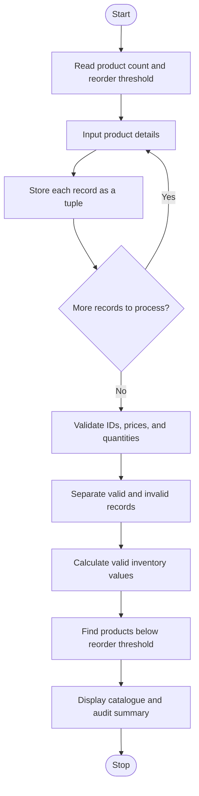

# Case Study 9: Tuple-Based Product Catalogue Audit

**Selected topic:** Topic 49 — Tuple-Based Product Catalogue Audit

## 1. Problem Statement

Store product identifiers, prices, and stock quantities in tuples. Audit the catalogue to detect invalid records, calculate the total inventory value for valid records, and identify products that require replenishment.

## 2. Objectives

- Represent each product record as a tuple containing product ID, product name, unit price, and stock quantity.
- Use tuple unpacking to access record fields.
- Validate product prices and stock quantities.
- Detect repeated product IDs.
- Calculate the inventory value of each valid product and the total valid inventory value.
- Identify products whose stock is below a user-supplied reorder threshold.
- Display a summary of valid and invalid records.

## 3. Assumptions

1. The number of records must be a positive whole number.
2. Product IDs and product names cannot be blank.
3. A unit price must be greater than zero.
4. Stock quantity must be a whole number greater than or equal to zero.
5. A repeated product ID is treated as an invalid record; the first occurrence is retained as valid if its other fields are valid, and later duplicate occurrences are flagged.
6. Inventory value is calculated as unit price multiplied by stock quantity.
7. A product requires replenishment when its quantity is **below** the user-supplied reorder threshold. A quantity exactly equal to the threshold is not flagged.
8. Invalid records are excluded from the valid inventory value and replenishment list.
9. Currency is represented in Indian rupees (Rs).
10. The solution uses basic Python features from the assigned syllabus: variables, data types, input/output, operators, conditions, loops, lists, tuples, and tuple unpacking.

## 4. Algorithm

1. Start.
2. Read and validate the number of product records.
3. Read and validate the non-negative reorder threshold.
4. For each product, read its ID, name, unit price, and stock quantity.
5. Store each record as a tuple in a list.
6. Examine every tuple using tuple unpacking.
7. Check for duplicate IDs, prices less than or equal to zero, and negative quantities.
8. Store invalid records with their error reasons; store remaining records as valid.
9. For each valid product, calculate inventory value as price × quantity and add it to the total.
10. Identify valid products whose stock is below the reorder threshold.
11. Display valid product details and inventory values.
12. Display products requiring replenishment, invalid records, and the audit summary.
13. Stop.

## 5. Flowchart



## 6. Pseudocode

```text
START
INPUT positive product_count
INPUT non-negative reorder_level
products = empty list

FOR each product record
    INPUT product_id, name, price, quantity
    STORE (product_id, name, price, quantity) as a tuple
    APPEND tuple to products
END FOR

valid_products = empty list
invalid_products = empty list
seen_ids = empty list

FOR each product tuple
    UNPACK tuple into product_id, name, price, quantity
    errors = empty list

    IF product_id already exists in seen_ids
        ADD duplicate ID error
    ELSE
        ADD product_id to seen_ids
    END IF

    IF price <= 0
        ADD invalid price error
    END IF
    IF quantity < 0
        ADD invalid quantity error
    END IF

    IF errors is empty
        ADD tuple to valid_products
    ELSE
        ADD tuple and errors to invalid_products
    END IF
END FOR

total_inventory_value = 0
FOR each valid product tuple
    inventory_value = price * quantity
    ADD inventory_value to total_inventory_value
    IF quantity < reorder_level
        MARK product for replenishment
    END IF
END FOR

DISPLAY valid catalogue and total inventory value
DISPLAY replenishment list
DISPLAY invalid records and reasons
DISPLAY audit summary
STOP
```

## 7. Python Source Code

The complete runnable program is in [main.py](./main.py).

## 8. Test Cases

| Test | Input / condition | Expected result |
|---|---|---|
| 1 | Positive price and non-negative stock | Record is valid |
| 2 | Price is zero | Record is flagged as invalid |
| 3 | Price is negative | Record is flagged as invalid |
| 4 | Quantity is negative | Record is flagged as invalid |
| 5 | Product ID is repeated | Later duplicate record is flagged |
| 6 | Stock is below the reorder threshold | Product appears in replenishment list |
| 7 | Stock equals the threshold | Product is not flagged for replenishment |
| 8 | All records are valid | Invalid-record section displays “None” |
| 9 | No valid products are entered | Valid catalogue is empty and total valid inventory value is Rs 0.00 |

## 9. Sample Input

For this example, use a reorder threshold of 10.

```text
Enter number of product records: 5
Enter minimum stock level (reorder threshold): 10

Product record 1
Product ID: P101
Product name: Notebook
Unit price (Rs): 45
Stock quantity: 120

Product record 2
Product ID: P102
Product name: Pen
Unit price (Rs): 10
Stock quantity: 500

Product record 3
Product ID: P103
Product name: Calculator
Unit price (Rs): 850
Stock quantity: 8

Product record 4
Product ID: P104
Product name: USB Drive
Unit price (Rs): 600
Stock quantity: 3

Product record 5
Product ID: P105
Product name: Damaged Item
Unit price (Rs): -50
Stock quantity: 10
```

## 10. Expected Output

```text
VALID PRODUCT CATALOGUE
ID          Product                 Price (Rs)     Stock      Value (Rs)
P101        Notebook                    45.00       120        5400.00
P102        Pen                         10.00       500        5000.00
P103        Calculator                 850.00         8        6800.00
P104        USB Drive                  600.00         3        1800.00

Total valid inventory value: Rs 19000.00

PRODUCTS REQUIRING REPLENISHMENT (stock below 10)
- P103 | Calculator | Current stock: 8
- P104 | USB Drive | Current stock: 3

INVALID PRODUCT RECORDS
- P105 | Damaged Item: price must be greater than zero

AUDIT SUMMARY
Total records entered: 5
Valid records: 4
Invalid records: 1
Products needing replenishment: 2

Catalogue audit complete.
```

*Note: The program's actual console output also includes headings, separator lines, and the prompts used to enter data.*

## 11. Output Screenshots

**To be added:** Run `main.py` with the sample input and capture a screenshot of the console showing the catalogue, inventory total, replenishment list, and invalid-record report. Upload the screenshot to this case-study folder in GitHub.

## 12. Conclusion

The Tuple-Based Product Catalogue Audit demonstrates how tuples can store structured product records and how tuple unpacking makes their fields easy to inspect. The program validates product data, identifies duplicate IDs and invalid prices or quantities, calculates valid inventory value, and highlights products below the replenishment threshold. This helps keep a simple product catalogue accurate and makes low-stock items easier to identify.
