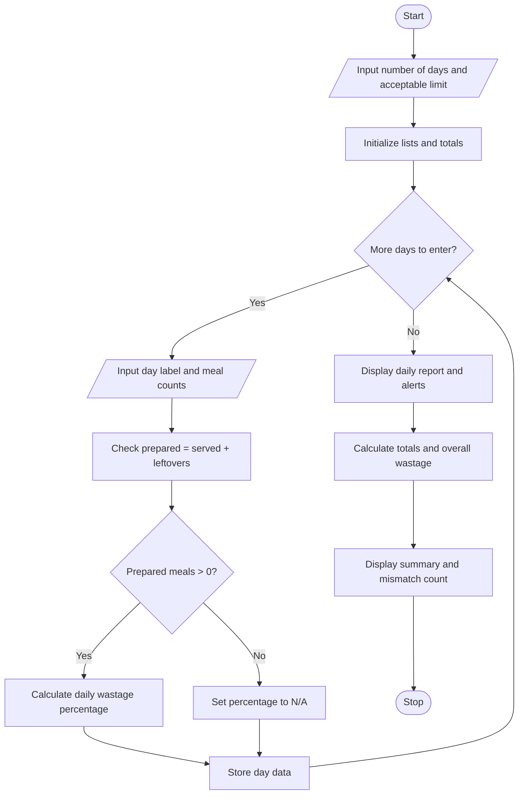

# Case Study 10: Food Waste Monitoring System

## 1. Problem Statement
Compare prepared meals, meals served, and leftovers across several days; calculate wastage percentages and identify days exceeding acceptable limits.

## 2. Objectives
- Record meal counts for multiple days.
- Calculate daily and overall food-wastage percentages.
- Identify days whose wastage percentage exceeds the user-defined acceptable limit.
- Compare prepared, served, and leftover counts and flag inconsistent records.

## 3. Assumptions
- The number of days must be a positive whole number.
- Meal counts must be non-negative whole numbers.
- The acceptable wastage limit is entered as a percentage from 0 to 100.
- Daily wastage percentage is calculated as `leftovers / meals prepared * 100`.
- A day exceeds the limit only when its wastage percentage is greater than the limit; equality is considered within the limit.
- For a day with zero meals prepared, the wastage percentage is shown as N/A to avoid division by zero.
- A record is consistent when `meals prepared = meals served + leftovers`. Mismatches are reported but retained in the wastage calculations so that the user can review the entered data.
- These validation and threshold details are implementation assumptions because the case prompt does not prescribe exact rules.

## 4. Algorithm
1. Start.
2. Read and validate the number of days.
3. Read and validate the acceptable wastage percentage.
4. For each day:
   - Read a non-empty day label.
   - Read prepared, served, and leftover meal counts; reject negative or non-integer values.
   - Check whether prepared meals equal served meals plus leftovers.
   - If prepared meals are greater than zero, calculate wastage percentage; otherwise record it as N/A.
   - Store the day's data in lists.
5. Display the daily counts, wastage percentage, threshold status, and consistency check.
6. Calculate totals for prepared, served, and leftover meals.
7. Calculate and display overall wastage percentage when total prepared meals are greater than zero.
8. Count and display days with inconsistent meal counts.
9. Stop.

## 5. Flowchart


## 6. Pseudocode
```text
START
INPUT number_of_days
INPUT acceptable_limit
FOR each day
    INPUT day_label, prepared, served, leftovers
    consistent = (prepared == served + leftovers)
    IF prepared > 0
        wastage = leftovers / prepared * 100
    ELSE
        wastage = N/A
    END IF
    STORE values in lists
END FOR

DISPLAY each day's counts and wastage
IF daily wastage > acceptable_limit
    DISPLAY warning
END IF
DISPLAY consistency status for each day

CALCULATE total_prepared, total_served, total_leftovers
IF total_prepared > 0
    overall_wastage = total_leftovers / total_prepared * 100
    DISPLAY overall_wastage and threshold status
ELSE
    DISPLAY N/A
END IF
COUNT and DISPLAY inconsistent days
STOP
```

## 7. Python Source Code
File: [main.py](./main.py)

The program uses input validation, lists, loops, conditional statements, arithmetic operators, and formatted strings. It does not require external libraries.

## 8. Test Cases

| Test | Input / condition | Expected result |
|---|---|---|
| 1 | Prepared 100, served 90, leftovers 10; limit 15% | Wastage 10%; within limit; counts consistent |
| 2 | Prepared 120, served 96, leftovers 24; limit 15% | Wastage 20%; alert shown; counts consistent |
| 3 | Prepared 80, served 70, leftovers 10; limit 15% | Wastage 12.50%; within limit |
| 4 | Prepared 50, served 35, leftovers 15; limit 15% | Wastage 30%; alert shown |
| 5 | Prepared 10, served 7, leftovers 2 | Wastage 20%; mismatch flagged because 7 + 2 is not 10 |
| 6 | Prepared 0, served 0, leftovers 0 | Wastage shown as N/A; no division-by-zero error |
| 7 | Negative or non-integer meal count | Input is rejected and requested again |

## 9. Sample Input
```text
Enter number of days to monitor: 4
Enter acceptable wastage limit (0-100%): 15

Day 1
Enter day name/label: Monday
Meals prepared: 100
Meals served: 90
Leftover meals: 10

Day 2
Enter day name/label: Tuesday
Meals prepared: 120
Meals served: 96
Leftover meals: 24

Day 3
Enter day name/label: Wednesday
Meals prepared: 80
Meals served: 70
Leftover meals: 10

Day 4
Enter day name/label: Thursday
Meals prepared: 50
Meals served: 35
Leftover meals: 15
```

## 10. Expected Output Summary
- Monday: 10.00% wastage — within limit.
- Tuesday: 20.00% wastage — exceeds limit.
- Wednesday: 12.50% wastage — within limit.
- Thursday: 30.00% wastage — exceeds limit.
- Total prepared: 350 meals.
- Total served: 291 meals.
- Total leftovers: 59 meals.
- Overall wastage: 59 / 350 × 100 = **16.86%**, which exceeds the 15% limit.
- Days with meal-count mismatches: 0.

The program prints a detailed daily report and the overall summary when executed.

## 11. Output Screenshots
**To complete this deliverable:** Run `main.py` in Python and capture a screenshot showing the daily report and overall summary. Upload or add the screenshot to this folder/repository as required by the assignment. The expected output summary above is not a substitute for an actual execution screenshot.

## 12. Conclusion
The Food Waste Monitoring System compares meal preparation, serving, and leftovers over multiple days. It calculates daily and overall wastage percentages, flags days above the acceptable limit, and identifies meal-count mismatches. The project applies basic Python lists, loops, conditions, arithmetic, and input validation to a practical food-waste monitoring problem.
